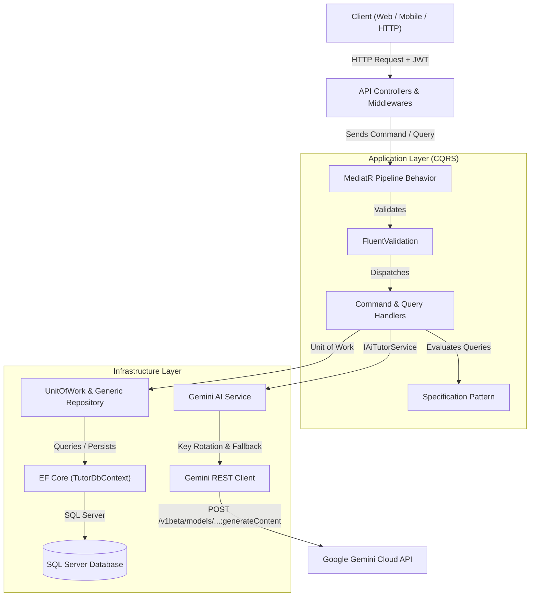

# English Tutor ChatBot API

[](https://dotnet.microsoft.com/)
[](https://learn.microsoft.com/en-us/dotnet/csharp/)
[](https://blog.cleancoder.com/)
[](https://learn.microsoft.com/en-us/ef/core/)
[](https://swagger.io/tools/swagger-ui/)
[](https://ai.google.dev/)

A production-grade ASP.NET Core Web API backend powering an intelligent English tutoring chat assistant designed specifically for preparatory-school students (ages 12–15). Built adhering to Clean Architecture principles, CQRS pattern with MediatR, and integrated with Google's Gemini LLMs featuring smart key rotation and automated failover.

---

## Highlights & Features

- **Domain-Driven & Clean Architecture**: Strict separation of concerns across Domain, Application, Infrastructure, and Presentation layers.
- **CQRS Pattern with MediatR**: Complete decoupling of write commands from read queries for maintainability and scalability.
- **Pedagogical AI Prompt Engineering**: System instructions tailored for middle-school learners with dual answering modes:
  - **Quick Mode**: Instant concise answers without filler for fast homework checks.
  - **Detailed Mode**: Comprehensive explanations in Arabic with grammatical rules, everyday English examples, and common mistakes to avoid.
- **High-Availability AI Client (Key Rotation & Failover)**:
  - Supports multiple Gemini API keys with round-robin rotation.
  - Automatic fallback cascade across models (`gemini-2.5-flash` &rarr; `gemini-2.0-flash` &rarr; `gemini-1.5-flash`) to gracefully circumvent HTTP 429 quota exhaustion.
  - Offline fallback demo mode when no API keys are provided.
- **Enterprise-Grade Identity & Security**:
  - ASP.NET Core Identity with password hashing and lockout protection.
  - JWT Bearer authentication with token validation and claim extraction.
  - Granular resource authorization ensuring students only access their own conversations.
- **Specification Pattern & Repository**: Dynamic filtering, pagination, and eager-loaded includes using reusable query specifications.
- **Modern Interactive Documentation**: Integrated with **Swagger UI (Swashbuckle)** for an intuitive, interactive API testing experience with JWT authorization support.
- **Centralized Exception Handling**: Middleware mapping custom domain exceptions into unified `ApiResponse<T>` envelopes.

---

## Architectural Flow



---

## Solution Structure

```
backend/
├── EnglishTutor.Api/             # Web API Startup Project (Entry Point)
│   ├── Controllers/             # REST controllers (Account, Sessions, Messages)
│   ├── Extensions/              # Auth & service registration helpers
│   ├── Middleware/              # GlobalExceptionHandlerMiddleware
│   └── Program.cs               # Minimal hosting, middleware pipeline, CORS & Swagger
│
├── EnglishTutor.Application/     # Class Library (CQRS & Business Logic)
│   ├── Behaviors/               # MediatR validation pipeline behavior
│   ├── Common/                  # Standard ApiResponse<T> & configuration models
│   ├── Features/                # Vertical slice CQRS commands & queries
│   │   ├── Accounts/            # Register, Login, GetProfile
│   │   ├── ChatMessages/        # SendMessage with LLM generation
│   │   └── ChatSessions/        # CreateSession, GetMySessions, GetSessionById, Delete
│   ├── Interfaces/              # Abstractions (Repositories, UoW, Services)
│   └── Specifications/          # Query specification pattern contracts & classes
│
├── EnglishTutor.Domain/          # Class Library (Core Domain Entities & Enums)
│   ├── Entities/                # ApplicationUser, ChatSession, ChatMessage
│   ├── Enums/                   # MessageRole, AnswerMode (Quick, Detailed)
│   └── Exceptions/              # Domain-specific custom HTTP exceptions
│
└── EnglishTutor.Infrastructure/  # Class Library (EF Core, Gemini Client & Persistence)
    ├── Configurations/          # EF Core Fluent entity configurations
    ├── Migrations/              # EF Core database schema migrations
    ├── Persistence/             # TutorDbContext
    ├── Repositories/            # Thread-safe UnitOfWork & GenericRepository
    └── Services/                # TokenService, CurrentUserService, Gemini AI client
```

---

## Tech Stack & Libraries

| Technology | Purpose |
|---|---|
| **.NET 10 / ASP.NET Core** | Core runtime and Web API framework |
| **Entity Framework Core 10** | Object-Relational Mapping (ORM) |
| **Microsoft SQL Server** | Relational database storage |
| **ASP.NET Core Identity** | User authentication, identity management & password security |
| **System.IdentityModel.Tokens.Jwt** | Token generation and validation |
| **MediatR** | In-process mediator pattern for CQRS implementation |
| **FluentValidation** | Strongly-typed business validation rules |
| **Swashbuckle.AspNetCore** | Interactive OpenAPI / Swagger UI sandbox |
| **Google Gemini API** | AI-powered grammar tutoring and language comprehension |

---

## Getting Started

### Prerequisites

- [.NET 10 SDK](https://dotnet.microsoft.com/download) (or compatible preview)
- Microsoft SQL Server (LocalDB, SQL Express, or Docker instance)
- A Google Gemini API key (optional for local offline inspection, required for live AI responses)

### 1. Clone & Setup Configuration

```bash
git clone https://github.com/ElGazery/EnglishTutor-ChatBot-Api.git
cd EnglishTutor-ChatBot-Api
```

Copy the example settings template to create your active configuration:

```bash
cp EnglishTutor.Api/appsettings.example.json EnglishTutor.Api/appsettings.json
```

Edit `EnglishTutor.Api/appsettings.json` with your connection string and API keys:

```json
{
  "ConnectionStrings": {
    "DefaultConnection": "Server=localhost;Database=EnglishTutorDb;Trusted_Connection=True;TrustServerCertificate=True;MultipleActiveResultSets=True;"
  },
  "JwtSettings": {
    "SecretKey": "YOUR_STRONG_SECRET_KEY_MINIMUM_32_CHARACTERS_LONG",
    "Issuer": "EnglishTutorApi",
    "Audience": "EnglishTutorClient",
    "ExpiryInMinutes": 60
  },
  "GeminiSettings": {
    "Model": "gemini-2.5-flash",
    "FallbackModels": [
      "gemini-2.5-flash",
      "gemini-2.0-flash",
      "gemini-1.5-flash"
    ],
    "ApiKeys": [
      "YOUR_GEMINI_API_KEY_1",
      "YOUR_GEMINI_API_KEY_2"
    ],
    "ApiKey": "YOUR_PRIMARY_GEMINI_API_KEY"
  }
}
```

### 2. Apply Database Migrations

Apply the included EF Core migrations to initialize the database:

```bash
dotnet ef database update --project EnglishTutor.Infrastructure --startup-project EnglishTutor.Api
```

### 3. Run the API

```bash
dotnet run --project EnglishTutor.Api
```

Once started:
- **Interactive API Docs (Swagger)**: `http://localhost:5082/swagger` (or your configured HTTPS port)
- **Health Check Endpoint**: `GET http://localhost:5082/health`

---

## API Endpoints Reference

### Authentication & Account

| Method | Route | Description | Auth Required |
|---|---|---|---|
| `POST` | `/api/account/register` | Register student user account | No |
| `POST` | `/api/account/login` | Authenticate user and receive JWT | No |
| `GET` | `/api/account/me` | Fetch authenticated user profile | Yes (Bearer) |

### Chat Sessions & Messages

| Method | Route | Description | Auth Required |
|---|---|---|---|
| `POST` | `/api/sessions` | Create a new tutoring conversation session | Yes (Bearer) |
| `GET` | `/api/sessions` | List all sessions owned by the authenticated student | Yes (Bearer) |
| `GET` | `/api/sessions/{id}` | Get session details and full conversation history | Yes (Bearer) |
| `DELETE` | `/api/sessions/{id}` | Delete a chat session and all its messages | Yes (Bearer) |
| `POST` | `/api/sessions/{sessionId}/messages` | Post student message and receive AI tutor response | Yes (Bearer) |

---

## Sample Request: Sending a Tutoring Message

**Request:**
```http
POST /api/sessions/1/messages
Authorization: Bearer <your_jwt_token>
Content-Type: application/json

{
  "message": "Why do we say 'She goes' instead of 'She go'?",
  "answerMode": "Detailed"
}
```

**Response:**
```json
{
  "statusCode": 200,
  "isSuccess": true,
  "message": "Reply generated successfully.",
  "data": {
    "studentMessageId": 14,
    "assistantMessageId": 15,
    "reply": "### قاعدة إضافة (s / es) مع المفرد الغائب\n\nفي زمن المضارع البسيط (Present Simple)، نضيف حرف **-s** أو **-es** للفعل إذا كان الفاعل مفرداً غائباً (He / She / It).\n\n- **القاعدة:** He / She / It + verb + s/es\n- **مثال:** *She goes to school every day.*\n- **خطأ شائع:** تجنب قول *She go* لأن الفاعل مفرد ويحتاج إلى تصريف الفعل معه.",
    "answerMode": "Detailed",
    "createdAt": "2026-11-05T20:45:00Z"
  },
  "errors": []
}
```

---

## Author

Crafted by **[ElGazery](https://github.com/ElGazery)**
